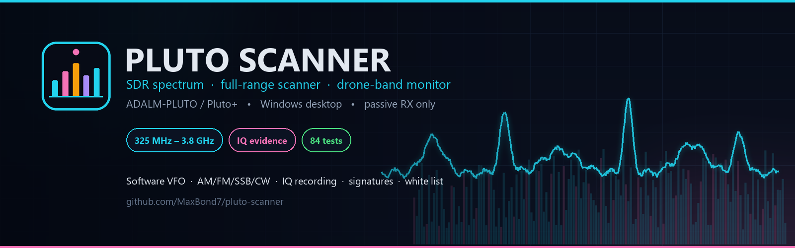
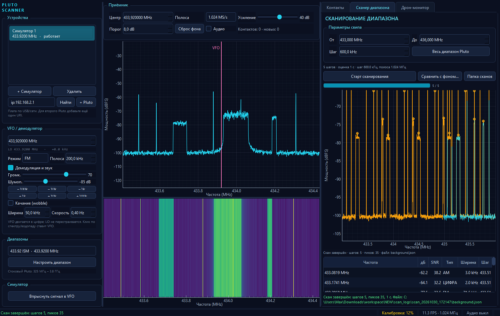
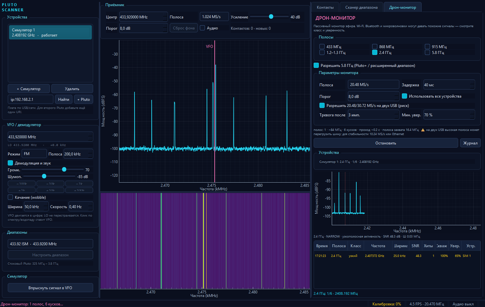
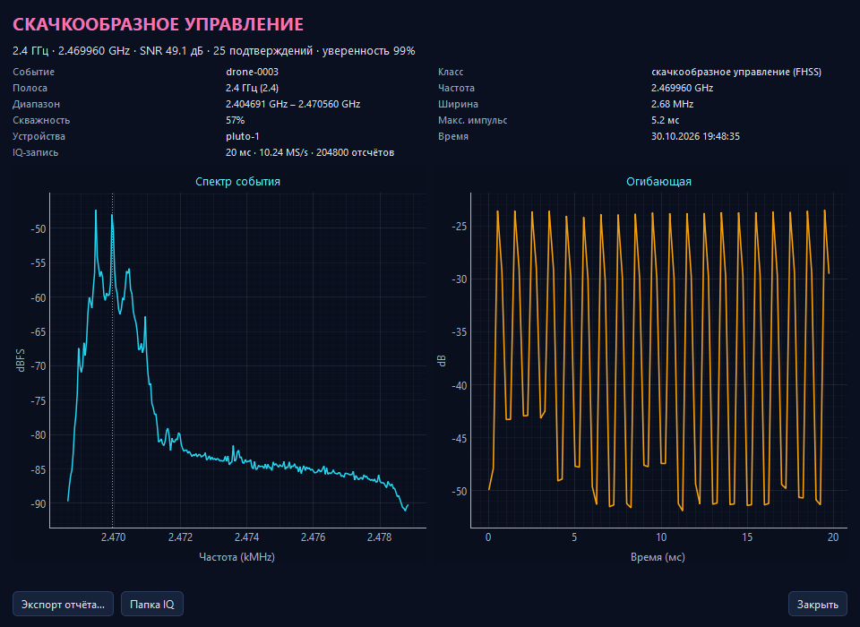
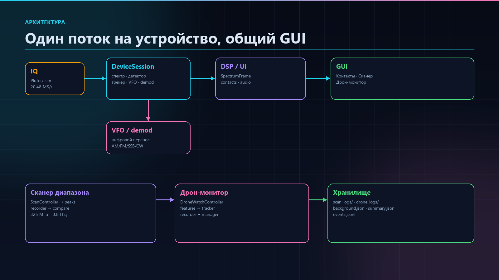
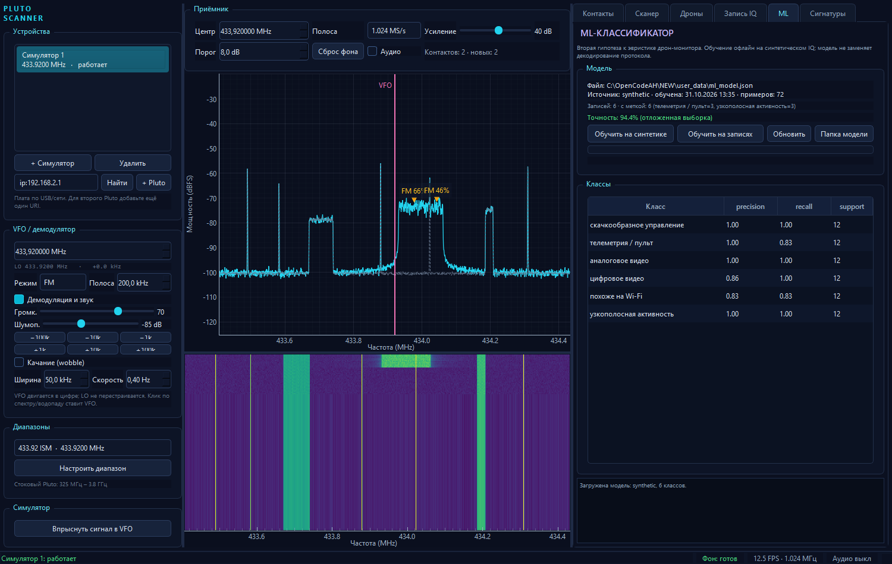

<p align="center">
  
</p>

<h1 align="center">Pluto Scanner</h1>

<p align="center">
  <b>Пассивный SDR-сканер для ADALM-PLUTO / Pluto+</b><br>
  спектр · водопад · программный VFO · демодуляция · полный свип · дрон-монитор · IQ-доказательства
</p>

<p align="center">
  
  
  
  
  
</p>

<p align="center">
  
</p>

<p align="center">
  <a href="#возможности">Возможности</a> ·
  <a href="#скриншоты">Скриншоты</a> ·
  <a href="#быстрый-старт">Быстрый старт</a> ·
  <a href="#архитектура">Архитектура</a> ·
  <a href="#документация">Документация</a> ·
  <a href="#честные-ограничения">Ограничения</a>
</p>

## Что это

**Pluto Scanner** — настольное приложение для пассивного приёма и исследования
эфира на ADALM-PLUTO / Pluto+. Оно закрывает путь от «вижу спектр» до
«сохранил доказательство»: живой спектр и водопад, программный VFO,
AM/FM/SSB/CW, свип 325 МГц – 3.8 ГГц, монитор дроновых полос, IQ-записи,
карточка события и локальная библиотека сигнатур.

Приложение **не декодирует протоколы и не определяет модель дрона**. Оно
показывает измеримые признаки и top-3 гипотезы с уверенностью. Это честная
эвристика по форме спектра и временной структуре, а не «здесь точно DVB-T2».

## Возможности

| | Возможность | Что внутри |
|---|---|---|
| 📡 | **Спектр и водопад** | dBFS, автошкала под шум, история, клик по частоте |
| 🎚 | **VFO и демодуляция** | программный перенос, wobble, AM / FM / SSB / CW, шумоподавитель |
| 🛰 | **Сканер диапазона** | 325 МГц – 3.8 ГГц, живой график, JSON-фон, сравнение свипов |
| 🚁 | **Дрон-монитор** | 433 / 868 / 915 МГц, 1.2–1.3 / 2.4 / 5.8 ГГц, два Pluto+ |
| 🧾 | **IQ-доказательства** | клип вокруг события, спектр + огибающая, экспорт bundle |
| 🧠 | **Библиотека сигнатур** | SQLite, seed-каталог, top-3, импорт/экспорт, открытые ссылки |
| 🎯 | **Белый список и фон** | подавление известных сигналов, профили шума по устройству/полосе/усилению |
| 💾 | **Длинная запись IQ** | cf32 + JSON, оценка размера, воспроизведение через DSP без платы |
| 🤖 | **ML-гипотеза** | встроенная синтетическая модель из коробки, обучение на своих записях, top-3 |
| 📥 | **Импорт данных** | SigMF и raw float32 IQ из открытых датасетов |
| 🪟 | **Windows-сборка** | portable ZIP, установщик Inno Setup, SHA256, версия и логи |

## Скриншоты

<table>
  <tr>
    <td width="50%" align="center">
      <br>
      <sub>Спектр, водопад, VFO и контакты</sub>
    </td>
    <td width="50%" align="center">
      <br>
      <sub>Дрон-монитор: полосы, события и тревоги</sub>
    </td>
  </tr>
  <tr>
    <td width="50%" align="center">
      <br>
      <sub>Карточка события и IQ-доказательство</sub>
    </td>
    <td width="50%" align="center">
      <br>
      <sub>Архитектура: устройства → DSP → UI</sub>
    </td>
  </tr>
</table>

<p align="center">
  <br>
  <sub>ML-классификатор: офлайн-обучение и вторая гипотеза</sub>
</p>

## Быстрый старт

### 1. Готовая Windows-сборка

Готовые файлы: [GitHub Releases](https://github.com/MaxBond7/pluto-scanner/releases/tag/v0.9.0) — portable ZIP, установщик и `SHA256SUMS.txt`.

Собрать самому:

```powershell
git clone https://github.com/MaxBond7/pluto-scanner.git
cd pluto-scanner
py -3.10 -m venv .venv
.\.venv\Scripts\Activate.ps1
python -m pip install -r requirements.txt
python -m pip install pyinstaller
.\build_windows.ps1 -Clean -Installer
```

Результат:

```text
dist\PlutoScanner\PlutoScanner.exe          portable one-folder
dist\PlutoScanner-0.9.0-portable.zip        архив
dist\PlutoScanner-Setup-0.9.0.exe           установщик
dist\SHA256SUMS.txt
```

- **Portable** — распаковать архив и запустить `PlutoScanner.exe`.
- **Установщик** — ставится per-user, создаёт ярлыки и пункт удаления.
- **Данные**: portable — рядом с `.exe`; installed — `%LOCALAPPDATA%\PlutoScanner`.
- **Python на целевой машине не нужен.**

### 2. Запуск из исходников

```powershell
python -m pluto_scanner --sim
python -m pluto_scanner --device usb:1.6.5
```

Полная инструкция, параметры CLI и проверка на чистой Windows —
в [Подробной установке](#подробная-установка-и-запуск) ниже.

## Архитектура

<p align="center">
  
</p>

```text
IQ (Pluto / симулятор / запись)
  -> окно Hann + FFT -> dBFS
  -> медианный фон + гистерезисный детектор
  -> трекер контактов (ID, hits/misses, known)
  -> top-3 гипотезы + библиотека сигнатур
  -> спектр + водопад
  -> программный DDC/VFO -> AM/FM/SSB/CW -> sounddevice
```

Один `QThread` на устройство; DSP и UI — в главном потоке. Медленный USB не
блокирует отрисовку, а зависший GUI не меняет тайминг IQ.

## Честные ограничения

- **Только пассивный приём.** Приложение ничего не передаёт.
- **dBFS, не dBm.** Для абсолютной мощности нужна калибровка тракта и антенны.
- **Классификация — гипотезы.** Форма спектра не заменяет декодирование
  протокола, Remote ID или датасет.
- **Второй RX / 2R2T** зависит от прошивки; текущая плата отдаёт 1R1T.
  U-Boot-трюк проверен и опасен — см. [PLUTO_2R2T](docs/PLUTO_2R2T.md).
- **KerberosSDR / пеленг** требует 4 антенны, кабели и калибровку.
- **ML-классификатор** — из коробки идёт синтетическая модель; для реальной
  точности обучите на размеченных записях. Без веба и телефона.

## Документация

| Документ | О чём |
|---|---|
| [ARCHITECTURE](docs/ARCHITECTURE.md) | слои, потоки, данные, режимы |
| [PACKAGING](docs/PACKAGING.md) | сборка, ZIP, установщик, чистая Windows |
| [SIGNATURES](docs/SIGNATURES.md) | библиотека сигнатур и источники |
| [ML](docs/ML.md) | модель, признаки, синтетика, разметка записей |
| [DATASETS](docs/DATASETS.md) | внешние IQ-датасеты, лицензии и импорт |
| [PLUTO_2R2T](docs/PLUTO_2R2T.md) | второй RX, 2R2T, риски и восстановление |
| [HARDWARE](docs/HARDWARE.md) | что есть, чего не хватает, ограничения |
| [ROADMAP](docs/ROADMAP.md) | что сделано и что дальше |
| [GITHUB](docs/GITHUB.md) | публикация, версии и оформление |
| [CHANGELOG](CHANGELOG.md) | история версий |

## Статус и лицензия

- Версия: **0.9.0**
- Тесты: **94 passed** (`pytest`), симулятор и реальные Pluto+
- Лицензия: **MIT** — см. [LICENSE](LICENSE); сторонние компоненты —
  [THIRD_PARTY_NOTICES.md](THIRD_PARTY_NOTICES.md)
- Репозиторий открыт: <https://github.com/MaxBond7/pluto-scanner>
- Локальные данные (`user_data/`, `iq_recordings/`, логи, клипы) в Git не попадают

## Участие

Проект открыт для участия:

- перед изменениями — [CONTRIBUTING.md](CONTRIBUTING.md);
- об уязвимостях — [SECURITY.md](SECURITY.md), не в публичных issue;
- идеи и баги — через GitHub Issues;
- новые сигнатуры — с открытым источником, лицензией и примером измерения.

<p align="center">
  <sub>Сделано для пассивного наблюдения за эфиром. Без обещаний того,
  чего не может измерить железо.</sub>
</p>

---

## Подробная установка и запуск

### Готовая сборка для Windows

```powershell
.\build_windows.ps1 -Clean -Installer
```

Результат:
- `dist\PlutoScanner\PlutoScanner.exe` — portable one-folder;
- `dist\PlutoScanner-<версия>-portable.zip`;
- `dist\PlutoScanner-Setup-<версия>.exe` — установщик Inno Setup;
- `dist\SHA256SUMS.txt`.

Python на целевой машине не нужен: внутри уже есть PySide6, numpy, scipy,
pyqtgraph, sounddevice, pyadi-iio и библиотеки libiio.

Где лежат данные:
- portable-сборка — рядом с `.exe`, маркер `portable.flag`;
- установленная версия — `%LOCALAPPDATA%\PlutoScanner`, чтобы Program Files
  оставался только для чтения;
- логи — `pluto_scanner.log` в той же папке данных.

Сборка проверена с симулятором и реальным Pluto+ по USB. Подробности,
ограничения и чеклист — в `docs/PACKAGING.md`.

### Запуск из исходников

Windows PowerShell, из папки `NEW`:

```powershell
py -3.10 -m venv .venv
.\.venv\Scripts\Activate.ps1
python -m pip install -r requirements.txt

# Только симулятор:
python -m pluto_scanner --sim

# Реальный Pluto:
python -m pip install pyadi-iio
python -m pluto_scanner --device usb:1.6.5
```

Номер USB-контекста (`usb:1.6.5`) зависит от того, в какой порт включён Pluto и сколько USB-устройств уже открыто. Точный URI показывает кнопка **«Найти»** или команда:

```powershell
.\.venv\Scripts\python.exe -c "from pluto_scanner.devices.pluto import scan_pluto_uris; print(scan_pluto_uris())"
```

Если URI заранее неизвестен, запустите приложение, нажмите **«Найти»**, выберите найденный `usb:...` или `ip:...` и нажмите **«+ Pluto»**. Для сетевого Pluto обычно подходит `ip:192.168.2.1` или `pluto.local`.

### Ярлык вместо терминала

На рабочем столе создан ярлык **Pluto Scanner**. Он запускает приложение через `pythonw.exe`, поэтому окно терминала не появляется. При старте лаунчер сам ищет подключённые Pluto: добавляет **все найденные USB-контексты**, а если их нет — IP-контексты. Если ничего не найдено, открывается симулятор. Копия ярлыка лежит в `NEW\Pluto Scanner.lnk`.

Если папка `NEW` будет перемещена, ярлык нужно пересоздать. Ручной запуск всё равно доступен:

```powershell
.\.venv\Scripts\python.exe launch_pluto_scanner.py
```

### Параметры запуска

```text
--sim                         добавить симулятор (по умолчанию он и так один, если нет --device)
--device URI                  Pluto; можно повторять для нескольких устройств
--center Hz                   начальная частота LO, по умолчанию 433920000
--sample-rate S/s             начальная частота дискретизации, по умолчанию 1024000
--fft N                       размер FFT, по умолчанию 2048
--no-audio                    заблокировать аудио (по умолчанию оно выключено)
--smoke-test --screenshot F   запустить, впрыснуть тестовые сигналы, сохранить скриншот и выйти
--log-level DEBUG|INFO|WARNING|ERROR
--scan                        сразу запустить свип диапазона
--scan-start HZ               начало свипа (по умолчанию 325 МГц)
--scan-end HZ                 конец свипа (по умолчанию 3.8 ГГц)
--scan-step HZ                шаг свипа (по умолчанию 0.8 * полоса захвата)
--scan-threshold DB           порог пика над шумом шага
--compare BACKGROUND          фон для сравнения (background.json)
--quit-after-scan             выйти после завершения/остановки свипа
--screenshot-after-scan PNG   сохранить экран после свипа и выйти
--drone                       сразу запустить дрон-монитор
--drone-bands KEYS            полосы: 433,868,915,1.2,2.4,5.8
--drone-rate S/s              полоса захвата монитора (по умолчанию 20.48 MS/s)
--drone-dwell MS              задержка на кусок (по умолчанию 40 мс)
--drone-threshold DB          порог над шумом (по умолчанию 8 дБ)
--drone-stable-usb            принудительно 10.24 MS/s для двух USB
--drone-alarm-hits N          сколько подтверждений нужно для тревоги (по умолчанию 3)
--drone-alarm-conf PCT        минимальная уверенность для тревоги (по умолчанию 70)
--drone-no-iq                 не сохранять IQ-фрагменты событий
--drone-seconds SEC           остановить монитор через N секунд
--quit-after-drone            выйти после остановки монитора
--screenshot-after-drone PNG  сохранить экран после монитора
--record SEC                  записать raw IQ с выбранного устройства
--quit-after-record           выйти после окончания записи
--screenshot-after-record PNG сохранить экран после записи
--play FILE                   открыть .cf32-запись для воспроизведения
--rx-info                     показать, сколько RX-каналов отдаёт прошивка
--train-ml                    обучить ML-модель на синтетике и выйти
--ml-per-class N              синтетических блоков на класс (по умолчанию 60)
--ml-epochs N                 эпох обучения (по умолчанию 600)
--version                     показать версию
```

Импорт внешнего датасета:

```powershell
python -m pluto_scanner.ml.import_dataset --format sigmf `
  --src dataset.sigmf-meta --label WIFI
```

Примеры:

```powershell
# Один Pluto, 1.024 MS/s, 433.92 МГц
python -m pluto_scanner --device usb:1.6.5 --center 433920000 --sample-rate 1024000

# Два Pluto и симулятор
python -m pluto_scanner --device usb:1.6.5 --device ip:192.168.2.1 --sim

# Быстрая проверка интерфейса без железа
python -m pluto_scanner --sim --no-audio --smoke-test --screenshot sim_smoke.png

# Короткий свип на симуляторе: 433–436 МГц, шаг 600 кГц
python -m pluto_scanner --sim --no-audio --scan `
  --scan-start 433000000 --scan-end 436000000 --scan-step 600000 `
  --quit-after-scan --screenshot-after-scan scan_sim.png

# Реальный Pluto: полный паспортный диапазон
python -m pluto_scanner --device usb:1.6.5 --no-audio --scan `
  --scan-start 325000000 --scan-end 3800000000 --scan-step 819200

# Дрон-монитор на реальном Pluto+: 2.4 и 5.8 ГГц, 15 секунд
python -m pluto_scanner --device usb:1.6.5 --no-audio --drone `
  --drone-bands 2.4,5.8 --drone-rate 20480000 --drone-seconds 15 `
  --quit-after-drone --screenshot-after-drone drone.png

# Записать 10 секунд IQ и выйти
python -m pluto_scanner --device usb:1.6.5 --no-audio --record 10 --quit-after-record

# Воспроизвести запись без платы
python -m pluto_scanner --play iq_recordings\iq_20261031_120000.cf32

# Проверить, включён ли второй RX (2R2T)
python -m pluto_scanner --rx-info
```

## Работа с интерфейсом

- **Центр / Полоса** — LO и частота дискретизации. Смена LO или полосы сбрасывает старый фон; это нормально, частотная ось изменилась.
- **Усиление** — усиление RX. Для этого Pluto используется `rx_hardwaregain_chan0` и ручной режим.
- **Порог** — превышение над фоном для появления сигнала. По умолчанию 8 dB; гистерезис выхода 4 dB.
- **Сброс фона** — заново собрать медианный фон. Полезно, если в калибровку попал постоянный передатчик, который нужно считать фоном.
- **VFO** — клик по спектру или водопаду переносит программный VFO. Строка `LO ... · +0.0 kHz` показывает, что LO остаётся на месте.
- **Качание** — включает синусоидальное движение VFO. Ширина в kHz, скорость в Hz.
- **Демодуляция и звук** — разрешает демодуляцию; отдельный чекбокс **Аудио** в верхней панели запускает звуковую карту. Шумоподавитель закрывает канал ниже порога.
- **Контакты** — двойной клик или **«Настроиться»** переводит VFO на контакт и подбирает режим/полосу. **«В фон»** запоминает частоту как известную, **«Забыть»** удаляет её из списка известных.
- Известные контакты хранятся в `NEW/user_data/known_contacts.json`.

## Запись IQ

Вкладка **«Запись IQ»** пишет сырой IQ с выбранного устройства в формате
`cf32` (комплексные float32, I/Q подряд, little-endian).

- Длительность задаётся от 1 до 60 секунд; рядом показана оценка размера.
- Перед стартом проверяется свободное место с запасом 64 МБ.
- Запись идёт в отдельном потоке, поэтому интерфейс не замирает.
- Если диск не успевает, потерянные отсчёты считаются и попадают в метаданные.
- Пока идёт запись, перестройка LO, полосы и усиления заблокирована.
- Файлы лежат в `NEW/iq_recordings/` (в Git не попадают):

```text
iq_recordings/
  iq_20261031_120000.cf32   raw IQ
  iq_20261031_120000.json   частота, полоса, усиление, длительность, статус
```

Размер: `8 байт × частота дискретизации × секунды`.
Например, 10 секунд при 1.024 MS/s — около 82 МБ, при 10.24 MS/s — около 819 МБ.

**Воспроизведение** добавляет запись как отдельное устройство: работают
спектр, водопад, контакты, VFO и демодуляция. Частота и полоса берутся из
метаданных и не меняются; аудио и VFO работают как обычно.

Незавершённую запись (например, после падения приложения) можно открыть:
длительность восстанавливается по размеру файла, статус остаётся
«не завершена».

## Сканер диапазона

Сканер вынесен в отдельную вкладку **«Сканер диапазона»** справа, чтобы органы управления свипом не теснили приёмник, VFO и список контактов. Вкладка **«Контакты»** остаётся рядом. Во время сканирования обычный спектр и водопад продолжают показывать текущий шаг.

### Как работает свип

1. Задаются **От**, **До** и **Шаг**; кнопка **«Весь диапазон Pluto»** ставит 325–3800 МГц.
2. `ScanController` строит список центров LO так, чтобы *захваченные полосы* точно покрывали заданный диапазон: первый центр = `от + полоса/2`, последний = `до − полоса/2`.
3. Для каждого шага LO перестраивается через `DeviceSession`, затем сканер ждёт два свежих спектральных кадра именно с этим центром (тайм-аут 4 с на шаг).
4. Средний PSD шага анализируется собственным детектором: шумовая дорожка = медиана PSD, пики = области выше порога. Спур LO в центре вырезается, чтобы не давать ложный пик на каждом шаге.
5. Шаг сразу пишется в `step_XXXXX.json`; график и таблица обновляются на лету.
6. В конце пишется `background.json`, и если в `scan_logs` уже был фон — автоматически создаётся `compare.json`.

Оценка времени в панели считается по реальному темпу: на USB Pluto один шаг занимает около 0.2–0.3 с. Полный диапазон 325 МГц – 3.8 ГГц при шаге ~819 кГц — это примерно 4240 шагов и **12–18 минут**.

### Живой график

- **Бирюзовая линия** — спектр текущего шага.
- **Жёлтая линия** — накопленный максимум (max-hold) по уже просканированной части диапазона; она растёт слева направо по мере движения LO.
- **Оранжевые точки** — найденные пики.
- **Серая пунктирная линия** — фон, с которым сравнивали (появляется после сравнения).
- Ось Y автоматически подстраивается по перцентилям, поэтому и слабые, и сильные участки остаются читаемыми.

### Сохранение и сравнение

Каждый скан лежит в отдельной папке:

```text
scan_logs/
  scan_20261026_190515/
    step_00000.json      # спектр и пики одного шага
    step_00001.json
    ...
    background.json      # весь скан: пики, max-hold, mean, coverage
    compare.json         # автоматическое сравнение с предыдущим фоном
```

`background.json` содержит `scan_version: 2`, метаданные устройства (`kind`, `uri`, усиление, полоса), `peaks`, `steps` и `spectrum`:

```json
{
  "scan_version": 2,
  "device": {"kind": "pluto", "uri": "usb:1.6.5", "gain_db": 40.0},
  "range_start_hz": 433000000.0,
  "range_end_hz": 436000000.0,
  "steps_completed": 5,
  "peaks": [{"freq_hz": 433081900.0, "snr_db": 38.2, "type": "AM"}],
  "spectrum": {
    "bins": 8192,
    "max_hold_db": [-102.1, "..."],
    "mean_db": [-103.4, "..."],
    "coverage": [1, 1, 2, "..."]
  }
}
```

Сравнение делает две проверки:

- **по пикам** — новый пик, которому нет пары в фоне (допуск 50 кГц), считается новым контактом; совпавший, но более сильный на 6 дБ — изменившимся;
- **по max-hold спектру** — подъёмы фона шире порога, которые не дали узкого пика (широкополосные сигналы).

Дубли пиков из перекрывающихся шагов схлопываются. Сравнение идёт только по пересечению диапазонов: если фон снят на 433–436 МГц, а новый скан — на 325–3800 МГц, пики вне 433–436 МГц не считаются новыми. Если фон снят с другого типа устройства (симулятор ↔ Pluto), с другим усилением (>3 дБ), не содержит завершённых шагов или старой версией формата, автоматическое сравнение пропускается с предупреждением — иначе получились бы ложные «новые контакты». Ручное сравнение кнопкой **«Сравнить с фоном…»** доступно всегда.

## Дрон-монитор

Это **пассивный монитор радиоэфира**, а не декодер протоколов и не радар. Он ищет активность, характерную для дроновых линков, и честно показывает класс и уверенность. Полноценное «это точно DJI, летит туда, 2 км» одним Pluto+ невозможно — см. ограничения ниже.

### Полосы

| Полоса | Что обычно там | Статус |
|---|---|---|
| 433 МГц | пульты, телеметрия, LPD | штатно |
| 868 МГц | EU ISM, телеметрия | штатно |
| 915 МГц | US ISM, пульты | штатно |
| 1.2–1.3 ГГц | аналоговое/цифровое видео | штатно |
| 2.4 ГГц | управление, видео, Wi-Fi | штатно |
| 5.8 ГГц | FPV-видео, часть управления | только Pluto+ / расширенный диапазон или даунконвертер |

У stock ADALM-PLUTO паспортный диапазон 325 МГц – 3.8 ГГц, поэтому 5.8 ГГц ему недоступен. У подключённого Pluto+ проверено: LO ставится на 5800 МГц и приём идёт, поэтому флажок **«Разрешить 5.8 ГГц (Pluto+ / расширенный диапазон)»** включён по умолчанию. Если у вас обычный Pluto — снимите его и не выбирайте 5.8.

### Как работает

1. Выбираются полосы и полоса захвата: 10.24 / 20.48 / 30.72 MS/s. При 20.48 MS/s полезная ширина куска ~16.4 МГц.
2. Каждая полоса режется на перекрывающиеся куски: 2.4 ГГц — 6 кусков, 5.8 ГГц — 11, 1.2–1.3 ГГц — 18, 900 МГц — 2, 433 МГц — 1.
3. Устройство перестраивается на кусок, ждёт два свежих IQ-блока и анализирует второй. Задержка по умолчанию 40 мс на кусок.
4. Из IQ считаются: шумовая дорожка, SNR, занятая ширина, скважность, число и длительность посылок, «плоскость» спектра.
5. Спур LO/DC в центре куска вырезается (300 кГц), чтобы он не выглядел как сигнал на каждой частоте. Куски перекрываются, поэтому реальный сигнал у центра виден в соседнем куске.
6. Классификатор выдаёт один из классов:

| Класс | Признаки | Тревога |
|---|---|---|
| `FHSS` | короткие узкие посылки, скважность 10–75%, несколько посылок за блок | да |
| `TELEMETRY` | редкие узкие посылки, низкая скважность | да |
| `VIDEO_ANALOG` | непрерывный канал 3–10 МГц | да |
| `VIDEO_DIGITAL` | непрерывный/полунепрерывный канал 8–30 МГц | да |
| `WIFI` | 15–30 МГц, высокая «плоскость», 2.4/5.8 ГГц | нет |
| `NARROW` | узкий непрерывный носитель | нет |
| `UNKNOWN` | активность, похожая ни на что из списка | нет |

Wi-Fi специально не считается дроном по умолчанию: иначе детектор срабатывал бы на каждый роутер. Если дрон использует Wi-Fi-видеолинк, его легче поймать по Remote ID (нужен отдельный Wi-Fi/BLE-адаптер) или по анализу конкретной модели.

### Два Pluto+

- При старте лаунчер добавляет **все найденные USB-контексты**; для Ethernet можно передать несколько `--device ip:...`.
- Флажок **«Использовать все устройства»** делит куски между приёмниками: каждый сканирует свою часть полос, события объединяются в один журнал.
- Два Pluto+ на одном USB 2.0-контроллере не всегда тянут по 20.48 MS/s каждый. Приложение **не срезает скорость молча**: по умолчанию выбранная полоса сохраняется, но для двух USB показывается предупреждение. Для стабильной работы выберите **10.24 MS/s** или снимите галочку «Разрешить 20.48/30.72 MS/s на двух USB»; в CLI это `--drone-stable-usb`. Для 20.48+ на каждом лучше Gigabit Ethernet.
- Если после перегрузки USB одно устройство исчезло из системы, переподключите его. Для двух Pluto+ лучше активный USB-хаб с внешним питанием или разные USB-контроллеры: два SDR на одном порту могут не хватить по току.
- Два независимых Pluto+ не являются фазово-когерентной парой, поэтому это **не пеленгатор**. Они дают больше покрытия и параллельных полос, а не направление.

### Если Pluto+ пропадает

Симптомы `Broken pipe`, `No such device`, `No device found` или исчезновение из списка устройств почти всегда означают USB-кабель/порт/питание, а не ошибку DSP. Проверка:

```powershell
.\.venv\Scripts\python.exe -c "from pluto_scanner.devices.pluto import scan_pluto_uris; print(scan_pluto_uris())"
```

- проверьте каждую Pluto+ **по одной**;
- поменяйте кабель на заведомо data-кабель (не charge-only);
- попробуйте другой USB-порт/активный хаб;
- для постоянной работы двух устройств используйте Gigabit Ethernet;
- после `Broken pipe` переподключите устройство и перезапустите монитор.

### Журнал

```text
drone_logs/
  drone_20261030_153500/
    config.json      # полосы, частота дискретизации, устройства
    events.jsonl     # рождение/завершение событий
    summary.json     # все события, максимумы SNR, спектр, огибающая
    clips/
      drone-0001.cf32  # IQ-фрагмент события (little-endian complex64)
      drone-0001.json  # метаданные фрагмента
```

Событие содержит время, полосу, класс, частоту, ширину, SNR, количество подтверждений, скважность, длительность, уверенность, устройства, снимок спектра (256 точек) и временную огибающую.

**Двойной клик по строке события** открывает карточку:

- спектр события;
- временная огибающая;
- все параметры и подтверждения;
- информация об IQ-фрагменте;
- кнопка **«Экспорт отчёта…»** — сохраняет папку с `event.json`, `spectrum.csv`, `envelope.csv`, `clip.cf32` и `README.md`;
- кнопка **«Папка IQ»** — открывает папку с записью.

IQ-фрагмент пишется для событий, если включён чекбокс **«Писать IQ-фрагмент для событий»**. Один фрагмент — это один блок ~20 мс; при 10.24 MS/s это примерно 1.6 МБ, при 20.48 MS/s — около 3.2 МБ. За сессию сохраняется не больше 100 клипов; запись можно отключить.

### Почему тревог много и как их уменьшить

**Скорее всего, большинство тревог — ложные.** 2.4 ГГц — самый зашумлённый диапазон: Wi-Fi, Bluetooth, Zigbee/Thread, беспроводные мыши, камеры, микроволновки и датчики дают сигналы, похожие на FHSS/телеметрию. Класс `FHSS` означает «так выглядит скачкообразный линк», а не «это дрон».

В приложении теперь есть подтверждение тревог:

- событие сначала появляется в таблице как **кандидат** (оранжевое);
- тревога (красный баннер и звук) срабатывает только после **N подтверждений** и при уверенности выше порога;
- по умолчанию: **3 подтверждения, 70% уверенности**;
- столбец **«Хиты»** показывает, сколько раз событие подтвердилось.

Если тревог всё ещё много:

1. Поднимите **«Тревога после»** до 4–5 и **«Мин. увер.»** до 80–90%.
2. Поднимите **«Порог»** с 8 до 10–12 дБ.
3. Уменьшите усиление (например, 40 → 25–30 дБ), если рядом мощный Wi-Fi: перегрузка приёмника создаёт интермодуляционные «сигналы».
4. Проверьте антенну и кабель: плохой контакт/отсутствие антенны дают шум и спуры.
5. Начните с одной полосы: 2.4 ГГц или 5.8 ГГц, а не все сразу.
6. Для проверки нужен **известный передатчик** (второй Pluto+ в роли TX, генератор или реальный дрон). Без ground truth нельзя отличить настоящий линк от Wi-Fi.

### Ограничения

- **Wi-Fi, Bluetooth, микроволновки и беспроводные камеры** дают похожие широкополосные и импульсные сигналы. Детектор ошибается, поэтому в интерфейсе есть класс `WIFI` и порог уверенности.
- **Нет направления и дальности.** RSSI и один приёмник не дают пеленга; для него нужна фазированная антенна/второй когерентный канал.
- **Нет определения модели и протокола.** Это форма сигнала, а не декодирование OcuSync/Lightbridge и т.п.
- **Remote ID** (ASTM F3411) через Pluto не декодируется: нужен отдельный Wi-Fi/BLE-приёмник и программный декодер.
- **5.8 ГГц** зависит от конкретного Pluto+; проверяйте флажок и слушайте эфир.
- Приём только пассивный. Глушение и перехват — вне задач приложения и во многих странах незаконны.

## Белый список и обучение фону

Известные сигналы можно принять как фон, чтобы они не поднимали тревогу.

- В карточке события есть кнопка **«В белый список»**.
- Во вкладке «Дрон-монитор» — кнопка **«Белый список…»** для просмотра, удаления и очистки.
- Белый список хранится в `NEW/user_data/drone_whitelist.json`.
- Запись привязана к полосе, классу и диапазону частот; чужой сигнал в той же полосе не подавляется автоматически.
- Событие из белого списка остаётся в таблице серым, но не вызывает тревогу.

Профили шума:

- шумовая дорожка запоминается отдельно для устройства, полосы, усиления и полосы захвата;
- файл: `NEW/user_data/drone_background.json`;
- при следующем запуске сканер стартует с уже обученным фоном;
- это уменьшает ложные срабатывания после смены обстановки, но не заменяет свежую калибровку.

## Библиотека сигнатур

В приложении появилась вкладка **«Сигнатуры»** — локальная база типовых сигналов и открытых справочников.

- База: `NEW/user_data/signatures.db` (SQLite).
- При первом запуске загружается около 20 встроенных записей: FM/DVB, ADS-B, AIS, GPS L1, Wi-Fi 2.4/5, Bluetooth Classic/BLE, Zigbee, RC-пульты, LoRa, SiK/MAVLink, аналоговое FPV, дрон-линки 2.4/5.8, узкие несущие.
- Для каждой записи хранятся: диапазон, ширина, модуляция, скважность, импульс, hop-профиль, тип источника, заметки, ссылки, лицензия и уверенность.
- Поиск по названию/категории/модуляции.
- Импорт и экспорт **JSON/CSV**.
- В карточке события показываются **top-3 гипотезы** с процентом, причинами совпадения и ссылкой на источник.
- Это именно гипотеза: запись «Дрон-линк 2.4 (семейство)» не означает конкретную модель. Для модели нужны декодирование протокола, Remote ID или размеченный датасет.

Матчинг учитывает:

- попадание в диапазон;
- отношение ширины сигнала;
- скважность;
- совместимость класса (`FHSS`, `TELEMETRY`, `VIDEO`, `WIFI`);
- hop-профиль;
- приоритет источника.

Экспорт события теперь включает `matches.json` с найденными гипотезами.

## Как устроен тракт

```text
IQ (Pluto / симулятор)
  -> окно Hann + FFT -> dBFS
  -> медианный фон + гистерезисный детектор
  -> трекер контактов (ID, hits/misses, known)
  -> эвристический классификатор: top-3 гипотезы
  -> спектр + водопад
  -> программный DDC/VFO -> AM/FM/SSB/CW -> sounddevice
```

Важные детали:

- Один `QThread` на устройство; DSP и GUI живут в главном потоке. Медленный USB не блокирует отрисовку, а зависший GUI не меняет тайминг IQ.
- IQ реального Pluto — 12-битные отсчёты; перед DSP они делятся на 2048.0.
- VFO не перестраивает LO. При выходе за 48% полосы захвата контакт/клик может перестроить LO, но обычное движение VFO и wobble — только цифровое смешивание.
- Водопад хранит историю и подбирает уровни по перцентилям текущего кадра, поэтому шумовая дорожка не выглядит плоским фоном.

## Ограничения и честные допущения

- **dBFS, не dBm.** Уровни относительные; для абсолютной мощности нужна калибровка тракта и антенны.
- **Фон статический по замыслу.** Сигнал, который уже был во время калибровки, считается фоном и не появится как «новый». Нажмите «Сброс фона» после смены обстановки.
- **Классификация — гипотезы.** Это форма спектра, полоса, симметрия, заполненность и наличие пиков, а не декодирование протокола. Для цифровых сигналов приложение честно пишет «ЦИФРА», а не название стандарта.
- **Второй RX зависит от прошивки.** Если `--rx-info` показывает `rx_channels: 1`, второй антенный порт не подключён к потоку. Нужна 2R2T-прошивка; подробности — `docs/PLUTO_2R2T.md`. Проверенный на этой плате U-Boot-трюк с `attr_val=ad9361`/`mode=2r2t` приводил к потере USB — не повторять.
- **Широкополосные сигналы** (Wi-Fi, DVB и т.п.) при полосе захвата 1–2 MS/s видны фрагментом; классификатор не сможет определить стандарт по фрагменту.
- **Аудио** проверено на синтетическом IQ и через `sounddevice` на локальной звуковой карте; сквозной звук с реального Pluto зависит от антенны, уровня сигнала и настроек звуковой карты.
- **Стандартный ADALM-PLUTO** перестраивается примерно от 325 МГц до 3.8 ГГц. Приложение предупреждает, но не запрещает ввод за пределами паспортного диапазона: модифицированные Pluto/Pluto+ бывают шире.
- На Windows libiio требует UCRT. В коде есть обходной путь для `pylibiio`: `find_library("c")` подменяется на `ucrtbase.dll`. Если использовать `msvcrt.dll`, libiio освобождает XML-буфер не тем CRT и процесс падает с `0xC0000374` при завершении.

## Проверка и тесты

```powershell
.\.venv\Scripts\python -m pytest
```

Покрыты: спектр и dBFS-нормировка, калибровка/детектор, трекер контактов, классификатор, демодуляция, хранилище известных частот, симулятор, конфигурация/диапазоны, а также сканер: детектор пиков шага, запись/чтение JSON-бандла, сравнение фонов и совместимость, дрон-монитор: нарезка полос, признаки IQ, классификация, трекер событий, IQ-клипы и JSON-журнал, библиотека сигнатур: seed, SQLite, импорт/экспорт и матчинг, а также белый список и профили фона, длинная запись IQ и воспроизведение, ML-признаки и softmax-модель. Сейчас это 89 тестов.

Проверено на реальных Pluto+ (Rev.C): захват IQ, спектр и водопад на 433.92 МГц, 2.437 ГГц и 1.09 ГГц, реальный свип 433.0–434.2 МГц (2 шага, 0 пропусков, 3 пика), сохранение `background.json`, LO на 5.8 ГГц и приём на 20.48 MS/s, дрон-монитор 2.4 + 5.8 ГГц (10–32 события за 8–10 с; 20-МГц Wi-Fi в тесте ушёл в класс `WIFI`, но ложные срабатывания на Wi-Fi/Bluetooth возможны).

Два реальных Pluto+ на одном USB-контроллере: **10.24 MS/s на каждом — стабильно** (проверено 15 с, события от обоих устройств); **20.48 MS/s на обоих — нестабильно** (10 с работают, через 30 с одно устройство отваливается с `Broken pipe`, даже после перестановки кабелей). Это ограничение общей USB-шины/питания, а не детектора. Для двух потоков 20.48+ нужен Gigabit Ethernet или разные USB-контроллеры. Полный сценарий появления контакта, автоматическое сравнение и демодуляция проверяются на симуляторе.

## Структура

```text
NEW/
  pluto_scanner/
    devices/       PlutoWorker, SimulatorWorker, общий QThread-интерфейс
    dsp/           spectrum, detector, tracker, classifier, demod, audio
    scanner/       peaks, recorder, compare, controller (свип диапазона)
    drone/         bands, features, tracker, recorder, report, controller, manager
    ml/            features, synthetic IQ, softmax model, training CLI
    signatures/    models, seed, SQLite store, matcher
    ui/            главное окно, спектр, водопад, контакты, VFO, вкладки сканера, дронов и сигнатур
    engine.py      IQ -> DSP -> контакты -> аудио
    model.py       общие dataclass/enum
    store.py       JSON-хранилище известных контактов
    config.py      настройки, диапазоны, форматирование
    __main__.py    CLI и запуск Qt
  tests/
  packaging/       launcher, PyInstaller spec, version info
  dist/            готовая Windows-сборка (в Git не попадает)
  scan_logs/       результаты свипов (создаётся при первом скане)
  drone_logs/      события, спектры и IQ-фрагменты дрон-монитора
  iq_recordings/   длинные записи IQ: .cf32 + .json (создаётся при записи)
  user_data/       known_contacts · signatures.db · drone_whitelist · drone_background
  presentation/    PPTX/PDF/HTML-презентация проекта
  installer/       шаблон Inno Setup
  build_windows.ps1
  launch_pluto_scanner.py
  launch_pluto_scanner.vbs
  Pluto Scanner.lnk
  pyproject.toml
  requirements.txt
```
