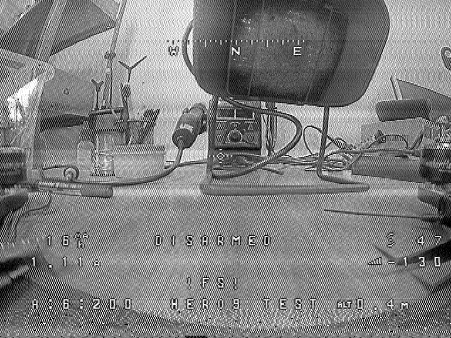
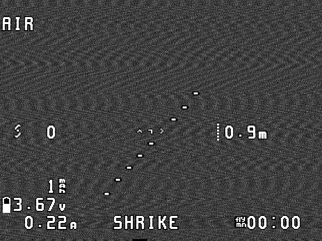

# Аналоговое FPV: датасет и проверка

## Датасет

**FPV Analogue Video IQ Dataset**, Zenodo `10.5281/zenodo.19870020`,
лицензия **CC BY 4.0**, автор Yelyzaveta Mashchenko, 2026.

- запись на **HackRF One**, 5.8 ГГц, **20 МС/с**, LNA/VGA 32/32;
- есть передачи аналогового VTX и эталонные записи без передатчика;
- 10 архивов `chunkN.zip`, всего около 28 ГБ;
- `iq_recording_meta.csv` описывает каждый свип: частоту, мощность,
  расстояние, окружение и папку с IQ;
- внутри архива `sweep_*/iq.bin` — чередующиеся **complex64** (8 байт
  на отсчёт); `sweep_*/metadata.csv` — свип по 20 МГц;
- блок в `metadata.csv` размечен как 262144 отсчёта, но вторая половина
  каждого блока — **нули записи**, а не сигнал. Реально в блоке
  131072 отсчёта (6.55 мс при 20 МС/с), а блоки идут вплотную друг к
  другу: 10 блоков дают непрерывные 65.5 мс, около четырёх полей PAL/NTSC.
  Инструменты сами отбрасывают нулевой хвост, поэтому склеенные блоки
  стыкуются по времени;
- `chunk1` содержит свипы с VTX на **5840 МГц**, 25 мВт, 1.5 м, помещение
  (камера NTSC);
- `chunk10` содержит свипы с VTX на **1240 МГц**, 25 мВт, 3 м, помещение
  (камера PAL).

Скачивание:

```powershell
.\.venv\Scripts\python.exe -m tools.download_fpv_analog `
  --dest "Z:\datasets\FPV_Analog" --chunks 10
```

## Как ищем строку

Аналоговое FPV-видео на 5.8 ГГц обычно **FM**, поэтому огибающая почти
ровная. Проверяются два пути:

1. **Огибающая** — пик 14–17 кГц (PAL 15.625, NTSC 15.734 кГц).
2. **FM-демодуляция** — производная фазы IQ, пик в той же полосе.
   Для 5.8 ГГц это основной путь.

Сила пика считается как отношение к медиане в полосе 5–30 кГц.
Порог — 6. Слабый пик 5–8 кГц у цифровых линков аналоговым не считается.

## Проверка файла

```powershell
# обычная запись
.\.venv\Scripts\python.exe -m tools.check_analog `
  --file capture.cf32 --rate 20e6 --format cf32 --seconds 0.5

# свип из датасета: читаются только блоки вокруг 1240 МГц
.\.venv\Scripts\python.exe -m tools.analyze_fpv_sweep `
  --iq ...\sweep_20260422_153008\iq.bin `
  --meta ...\sweep_20260422_153008\metadata.csv `
  --freq 1240e6
```

Инструменты печатают `sync_khz`, `fm_sync_khz`, силу, скважность, занятую
полосу и осторожный вердикт.

## Результаты на датасете

### Нормальная картинка с реального VTX

Два свипа дали настоящий кадр, а не полосы шума.

**1240 МГц, PAL** (`chunk10`, `sweep_20260422_153008`). Свип содержит
1.6 поля, поэтому декодер берёт одно полное поле и показывает его
удвоением строк — так же поступает кинескоп до прихода второго поля.
В кадре читаются OSD-надписи «SDR-200 HERO5 TEST», «DISARMED», «16.7»,
«1.1A», видны дрон, стол и кабели:



**5840 МГц, NTSC** (`chunk1`, `sweep_20260407_184542`). 65.5 мс дают три
полных поля, из них собирается настоящий черезстрочный кадр 480 строк.
В кадре OSD Betaflight: «SHRiKE», «AIR», 3.67 В, 0.22 А, «00:00»; сама
камера смотрит в ровную стену, поэтому фон почти без деталей:



Свип 5.8 ГГц удобен ещё и тем, что в нём есть и записи без передатчика:
на 5840 МГц мощность 0.166 против 0.038 в соседних каналах, то есть
полезный сигнал виден и по уровню.

### Строка и вердикт

`chunk10.zip`, три свипа на 1240 МГц, 25 мВт, 3 м:

| Свип | Огибающая | FM | Занято | Вердикт |
|---|---:|---:|---:|---|
| `sweep_20260422_153008` | 15.634 кГц ×36 | **15.636 кГц ×147** | 0.51 | аналоговый видеолинк |
| `sweep_20260422_153022` | 15.634 кГц ×38 | **15.636 кГц ×148** | 0.52 | аналоговый видеолинк |
| `sweep_20260422_153055` | 15.634 кГц ×22 | **15.636 кГц ×175** | 0.54 | аналоговый видеолинк |

Измеренные 15.636 кГц — это уход часов HackRF без TCXO: точная строка
кадра, которую находит декодер по всем синхроимпульсам сразу, равна
15.625 кГц с точностью до 0.1 Гц. Сила FM-пика 147–175 при пороге 6,
то есть запас большой.

Для сравнения, блок 100 МГц в том же свипе дал пик огибающей 8 кГц и
FM 26.6 кГц — это не аналоговое видео, вердикт «неоднозначно».

## Как собирается кадр

1. **Полоса.** FM-дискриминатор превращает в шум весь диапазон приёма,
   поэтому видео ограничивается полосой стандарта: 4.2 МГц для NTSC,
   5.5 МГц для PAL/SECAM. Без этого кадр утопает в снеге.
2. **Строка.** Позиции синхроимпульсов находятся по срезу ниже порога,
   а период считается по концентрации фаз: для верной частоты строки все
   импульсы попадают в одну фазу. Это устойчивее подгонки по каждой
   строке и не сбивается на ложных импульсах.
3. **Сетка.** По всем найденным импульсам строится одна прямая
   (наименьшие квадраты с отбраковкой выбросов). Сетка заодно учитывает
   постоянный уход часов камеры относительно SDR — иначе картинка
   уезжает на полстроки за поле и «двоится».
4. **Поле и кадр.** Широкие импульсы кадровой синхронизации (27 мкс,
   идут парами через полстроки) отмечают начало полей. Два полных поля
   сплетаются в черезстрочный кадр 480/576 строк; одно поле
   показывается удвоением строк; если кадровой синхронизации нет,
   строки складываются в частичный кадр.

## Просмотр видео

В 0.33.0 базовый ч/б режим живёт во **вкладке «Видео»** (первая слева), а
не в отдельном окне. Открыть можно вкладкой, меню «Вид → Аналоговое
видео…» (Ctrl+Shift+V) или кнопкой «Смотреть видео» в карточке события,
когда глубокий взгляд нашёл аналоговую строку. Он демодулирует FM/AM,
находит строки, собирает кадр и показывает его. Есть выбор PAL/NTSC/SECAM,
инверсия и снимок кадра.

Стандарт можно не угадывать: если измеренная частота строки ближе к
другому стандарту, декодер сам берёт его геометрию и пишет в строке
состояния фактический стандарт (например, NTSC при выбранном PAL).

Можно открыть и **записанный IQ**: выберите запись в панели устройств,
затем вкладку «Видео» и «Смотреть». Окно читает первые 2 секунды файла в
фоновом потоке и строит кадр, поэтому короткий свип из датасета тоже
подходит. Для извлечения одного блока из датасета есть
`tools/extract_fpv_recording.py`.

Ограничения: цвет не декодируется; при слабом сигнале возможен
вертикальный уход. Для блока датасета на 1240 МГц кадр — это одно поле,
то есть половина вертикального разрешения.

Приложение считает **качество кадра** по корреляции соседних строк:
у синтетического PAL/NTSC/SECAM оно около **0.98**. У реального кадра с
мастерской — **0.4–0.65**, у кадра с ровной стеной и OSD — около
**0.25**: корреляция измеряет детализацию сцены, а не факт приёма.
Поэтому «картинка» показывается и при собранном кадре, а «похоже на
шум/снег» — только если кадр не собрался и корреляция низкая.

## Ограничения

- Один приёмник, помещения, 5.8 и 1.2 ГГц; на других диапазонах и мощности
  порог силы может отличаться.
- Датасет не заменяет полевую запись: антенна, поляризация и помехи
  в реальности другие.
- Пик 15.6 кГц — признак аналогового видео, а не доказательство дрона:
  так же выглядит любой аналоговый видеопередатчик.
